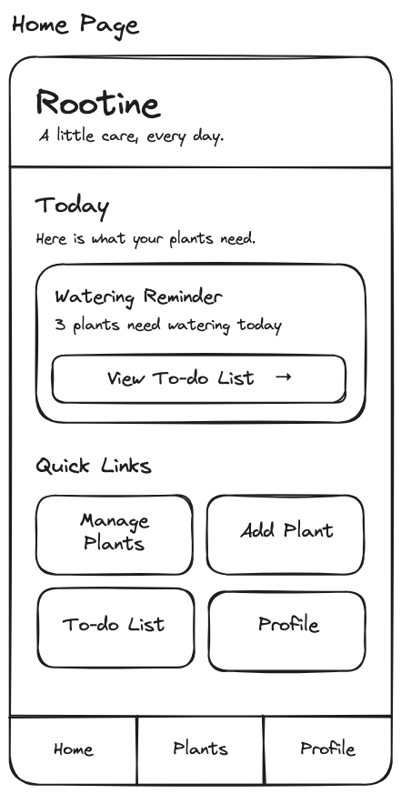
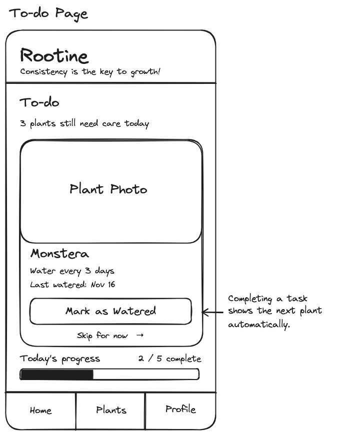
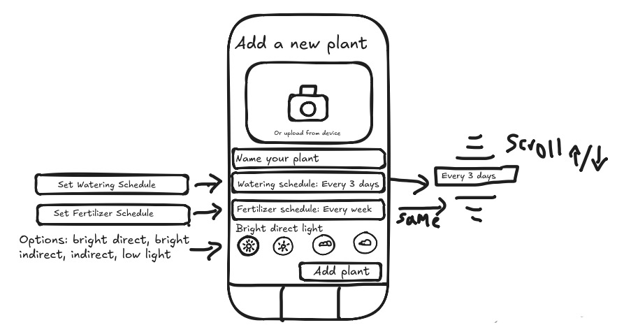
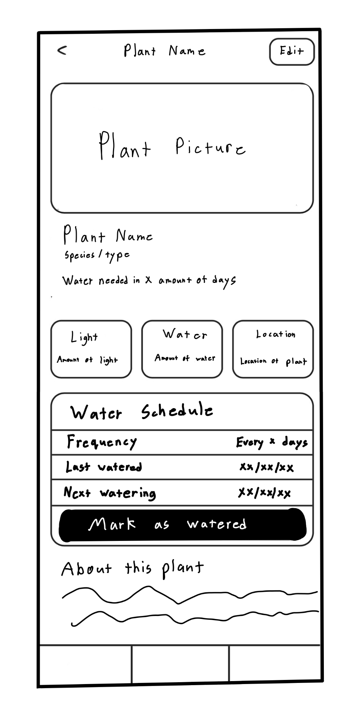
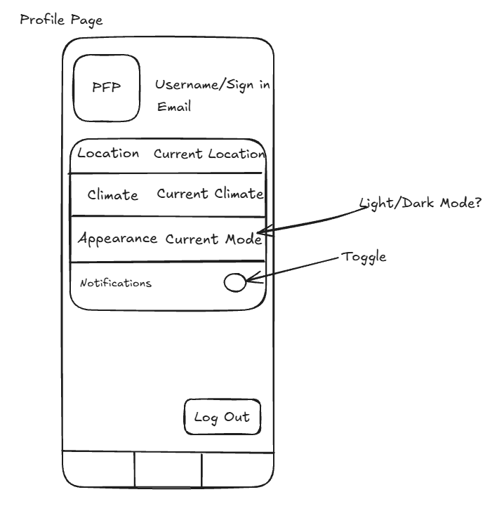
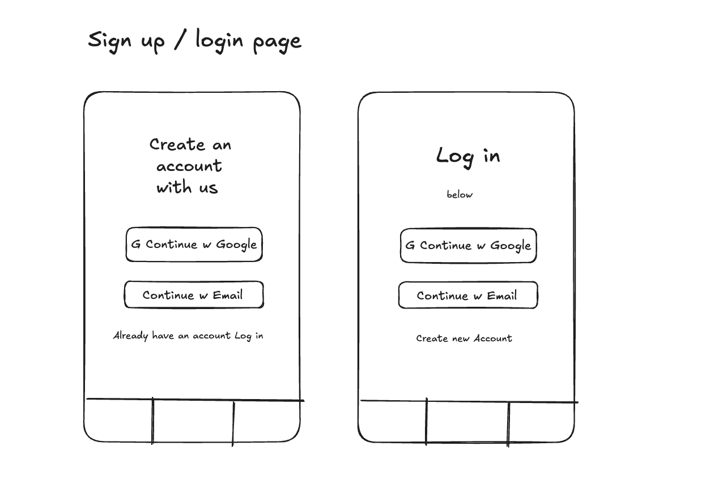

# Module 2 Group Assignment

CSCI 5117, Fall 2026, [assignment description](https://canvas.umn.edu/courses/579310/pages/project-2)

## App Info:

* Team Name: Team Rocket 🚀
* App Name: Rootine
* App Link: <https://TODO.com/>

### Students

* Dean Catlin, catli045@umn.edu
* Joyal Jijo, plach027@umn.edu
* Srish Kattegummula, katte035@umn.edu
* Ayman Siddiqui, siddi158@umn.edu
* Michael VerBout, verbo032@umn.edu

## Key Features

**Describe the most challenging features you implemented
(one sentence per bullet, maximum 4 bullets):**

* ...

Which (if any) device integration(s) does your app support?

* ...

Which (if any) progressive web app feature(s) does your app support?

* ...

## Mockup images

<!-- **[Add images/photos that show your mockup](https://stackoverflow.com/questions/10189356/how-to-add-screenshot-to-readmes-in-github-repository) along with a very brief caption:**

 -->

### Home Page

> This is the main landing page of the site for signed in users. It provides a simple overview of their daily plant care tasks, while also providing links to other important parts of the site. These include the to-do list, managing their plants, adding new plants, and their profile.

### To-Do Page

> The "To-Do" page allows users to go through a list of plants which currently need to be cared for that day. Each plant is displayed as a card where users can mark it as watered/fertilized/etc or skip it for now. Once a plant has been marked, the next card will automatically be displayed. There is also a progress bar at the bottom to help users keep track of how many plants they have taken care of for the day.

### Add Plant Page

> This page is used for adding new plants to a user's collection. Users can provide a name for their plant, take or upload a picture, and enter information about its watering frequency, fertilizer requirements, and lighting needs. This information is then used to keep track of when each plant needs to be taken care of and helps generate the user's daily to-do list.

### Plant Details Page

> The "Plant Details" page allows users to view information about a specific plant in their collection. This includes the plant's picture, species, location, watering requirements, and lighting needs. Users can also see when the plant was last watered and when it will need to be watered again. There is also an option to mark the plant as watered or edit its information if needed.

### Profile Page

> The "Profile" page allows signed in users to view their account information and manage some of their personal settings. These include their location and climate, light/dark mode preferences, and notification settings. Users can also sign out of their account from this page.

### Sign Up / Login Page

> The "Sign Up / Login" page allows new users to create an account and existing users to sign in. Users have the option to sign in using Google or their email. An account is required to access the main application, where each user has their own private collection of plants and care schedules.

## Testing Notes

**Is there anything special we need to know in order to effectively test your app? (optional):**

* ...

## Screenshots of Site (complete)

**[Add a screenshot of each key page](https://stackoverflow.com/questions/10189356/how-to-add-screenshot-to-readmes-in-github-repository)
along with a very brief caption:**

## External Dependencies

**Document integrations with 3rd Party code or services here.
Please do not document required libraries (e.g., VUE, Firebase, vuefire).**

* Library or service name: description of use
* ...

**If there's anything else you would like to disclose about how your project
relied on external code, expertise, or anything else, please disclose that
here:**

...
